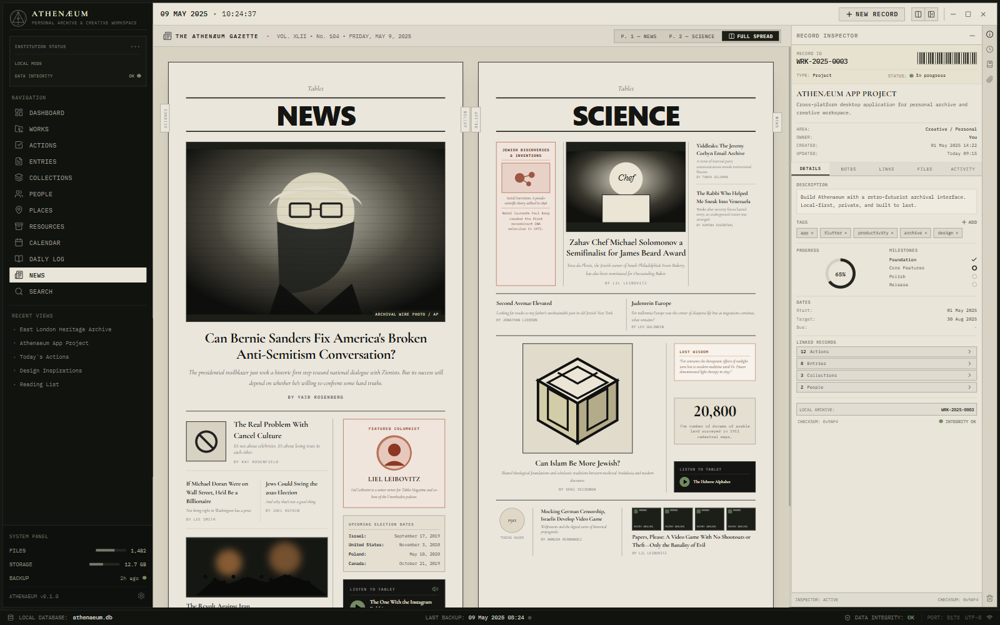

# ATHENÆUM — Personal Archive & Creative Workspace

> A sophisticated personal knowledge-management system and creative workspace designed with a vintage institutional archival computer interface aesthetic.



## Overview

**ATHENÆUM** blends a dense, utilitarian, editorial interface with high-performance desktop productivity tooling. Designed around an archival paper-and-charcoal visual philosophy, it offers a local-first system for cataloging works, tracking actions, maintaining daily logs, curating research collections, and exploring news dispatches.

## Key Features

- **Archival Dashboard**:
  - Continuous 5-metric overview bar with tabular figures (Calendar, Actions Due, Active Works, Weekly Entries, Focus Progress).
  - Multi-work portfolio cards with procedural technical line-art and architectural schematics.
  - Upcoming Actions table with real-time status toggling, priority dots, and time sorting.
  - Daily Log with reflections, progress indicators, and an energy gauge.
  - Curated collection highlights and recent archival entries.
- **Gazette & News Dispatches**:
  - High-density vintage broadsheet newspaper layout with warm newsprint parchment surface (`#EAE6DC`) and 1px black divider rules.
  - Dual editions matching classic broadsheet formats:
    - **Page 1 (`NEWS`)**: Lead halftone wire photo articles, cultural analysis essays, election schedules, featured columnist profiles, and statistical callouts.
    - **Page 2 (`SCIENCE`)**: Scientific breakthroughs, isometric perspective maze features, Nobel laureate history, and interactive archival audio dispatch player.
  - **Full Spread View**: Authentic dual-page side-by-side reading mode.
- **Universal Record Inspector**:
  - Persistent, synchronized side panel providing barcodes, checksums, hierarchical metadata, milestones, and relationship graphing across all entity types.
- **Complete Suite of Archive Views**:
  - Works, Actions, Entries, Collections, People, Places, Resources, Calendar, and Daily Log.
  - Full search modal with instant keyboard navigation (`/`).
  - New Record creation modal across all archival schema types.
- **Local-First Architecture**:
  - Powered by IndexedDB (`idb`) with full client-side persistence, data integrity validation, and local export/import capabilities.

## Tech Stack

- **Framework**: React 18
- **Styling**: Tailwind CSS
- **Icons**: Lucide React
- **Storage**: Client-side IndexedDB with multi-store schema
- **Build Tool**: Vite

## Getting Started

### Prerequisites

- Node.js (v18+)
- npm / pnpm / yarn

### Installation

```bash
# Clone the repository
git clone https://github.com/Deepjyoti78/athenaeum.git
cd athenaeum

# Install dependencies
npm install

# Start development server
npm run dev
```

The application will run locally on `http://localhost:5173`.

### Production Build

```bash
npm run build
```

The optimized static production bundle will be output to `/dist`.

## License

MIT
